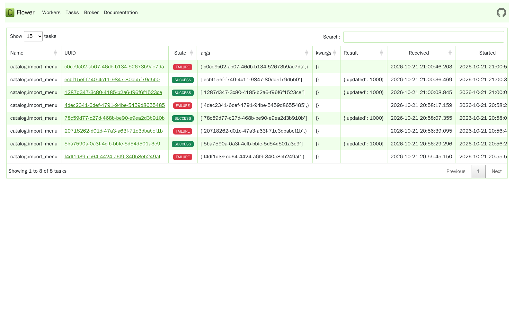

# DEV-55 - Evidencia y decisiones

## Alcance acordado

Brasaland dispone aqui de una API demo de catalogo, no de la API de produccion ni
del pipeline mencionados en el ejercicio. No habia operaciones pesadas existentes.
Se confirmo con el usuario agregar importacion por lotes y preservar GET /menu y
GET /locations, en lugar de romper sus contratos HTTP convirtiendolos en 202.
`POST /menu/imports` desacopla la actualizacion repetida de catalogo, reutilizando
las mismas reglas que los PUT existentes. No se afirma haber medido una operacion
pesada de produccion inexistente en este repositorio.

Archivos de ejecucion bajo `services/catalog-api`, Compose en la raiz,
documentacion bajo `docs` y sincronizacion de `memory-bank`. Sin cambios a
`infra`, `internal`, `data/raw` ni contratos TypeScript protegidos.

## Arquitectura

Cliente -> FastAPI -> SQLite (lote) -> Redis (UUID) -> Celery independiente
-> SQLite (catalogo/resultado atomicos) + Redis (estado/resultado).

El worker sigue funcionando sin FastAPI. SQLite comparte volumen entre
contenedores y revisiones por familia invalidan la cache local de la API.
DLQ persistente: tabla `dead_letters`, con ruta administrativa
`GET /tasks/dead-letter`. Flower representa esas tareas como FAILURE;
no presenta una tabla DLQ propia.

`max_retries=3` significa CUATRO ejecuciones totales en Celery. Se conserva
la configuracion explicita solicitada, con backoff 2/4/8 segundos y DLQ tras
el cuarto fallo. "Tres fallos totales" requeriria max_retries=2 y seria otro
contrato, no una equivalencia.

## Verificacion real - 2026-10-21

- Docker: Redis 7.4, Python 3.12, Celery 5.6.2, Flower 2.0.1.
- 22 pruebas unitarias pasaron; regresiones de cache y autenticacion incluidas.
- Compose estandar y override validan. El bridge entre contenedores de este
  Codespaces no permitia conexiones TCP; el override opcional aprobado comparte
  el namespace de red de Redis sin unir procesos ni tocar el sistema.
- POST de 1000 filas: **58.207 ms**, HTTP 202, con worker detenido.
- Redis contenia `args=["ecbf15ef-f740-4c11-9847-80db5f79d5b0"]`, no las filas.
- HTTP mostro pending con worker detenido. Pub/Sub del backend mostro STARTED
  y SUCCESS; HTTP devolvio success con `{"updated":1000}`.
- Trabajo completado mientras la API estaba detenida; tras reiniciarla el
  menu reflejo el cambio del worker.
- Fallo controlado por ID inexistente:
  `c0ce9c02-ab07-46db-b134-52673b9ae7da`, HTTP failure, error `Item not found`.
- DLQ SQLite: mismo UUID, attempt=4, error `Item not found`, timestamp
  `2026-10-21T21:00:54.208Z`.
- Flower `/tasks` devolvio 200 y presenta tareas SUCCESS y FAILURE.



## Fragmento de log real

```text
21:00:40.179 task_id=c0ce9c02-ab07-46db-b134-52673b9ae7da attempt=1 status=retry error=Item not found
21:00:40.202 Task catalog.import_menu[c0ce9c02-ab07-46db-b134-52673b9ae7da] retry: Retry in 2s: ValueError('Item not found')
21:00:42.187 task_id=c0ce9c02-ab07-46db-b134-52673b9ae7da attempt=2 status=started duration_ms=0
21:00:42.197 Task catalog.import_menu[c0ce9c02-ab07-46db-b134-52673b9ae7da] retry: Retry in 4s: ValueError('Item not found')
21:00:46.194 task_id=c0ce9c02-ab07-46db-b134-52673b9ae7da attempt=3 status=started duration_ms=0
21:00:46.205 Task catalog.import_menu[c0ce9c02-ab07-46db-b134-52673b9ae7da] retry: Retry in 8s: ValueError('Item not found')
21:00:54.203 task_id=c0ce9c02-ab07-46db-b134-52673b9ae7da attempt=4 status=failure duration_ms=1.277
21:00:54.213 task_id=c0ce9c02-ab07-46db-b134-52673b9ae7da attempt=4 status=failure error=Item not found
```

## Reproducir

Seguir el README de la raiz y `services/catalog-api/README.md`, conservar el
mismo token local y ejecutar `python services/catalog-api/verify_async.py`.
La medicion es local, no un SLA universal: almacenamiento, tamaño del lote,
red y carga afectan latencia. Esta demo esta limitada a 1000 filas por lote.
Los limites de produccion (outbox, retencion, caidas duras, autenticacion y
SQLite en un solo host) estan documentados en la guia del servicio.